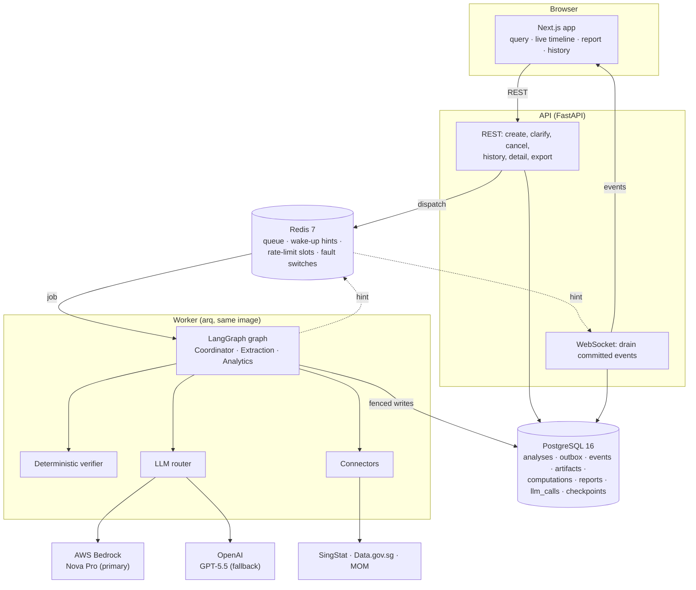
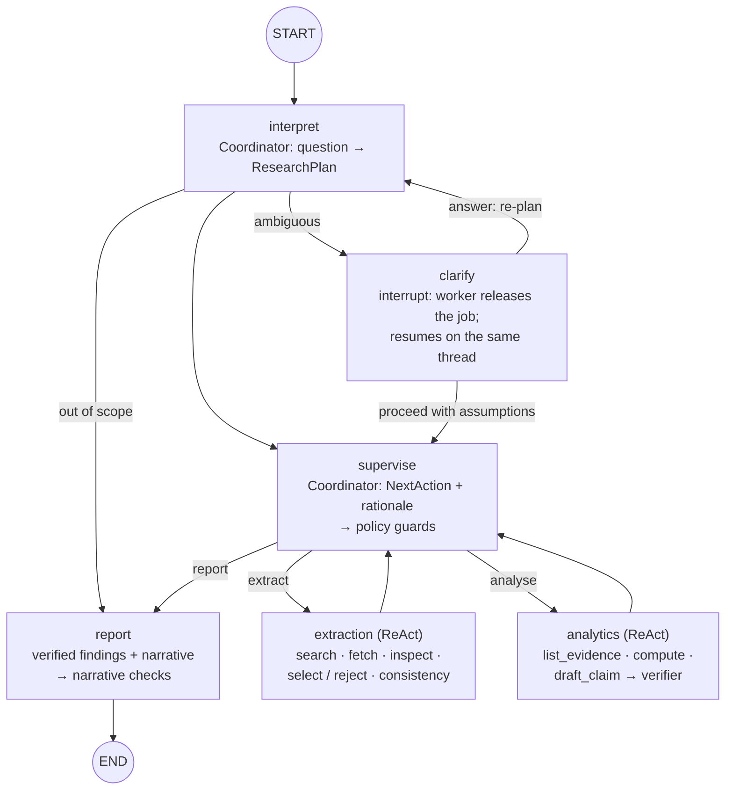
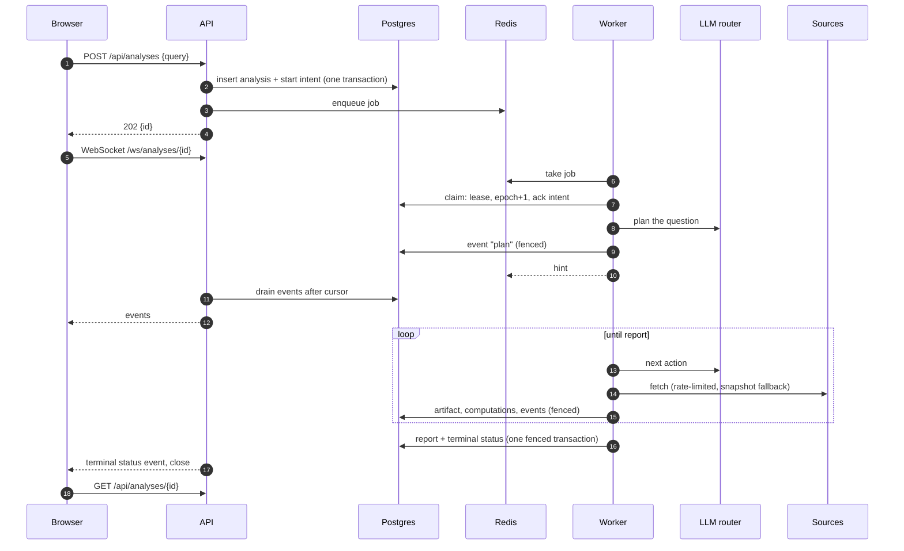
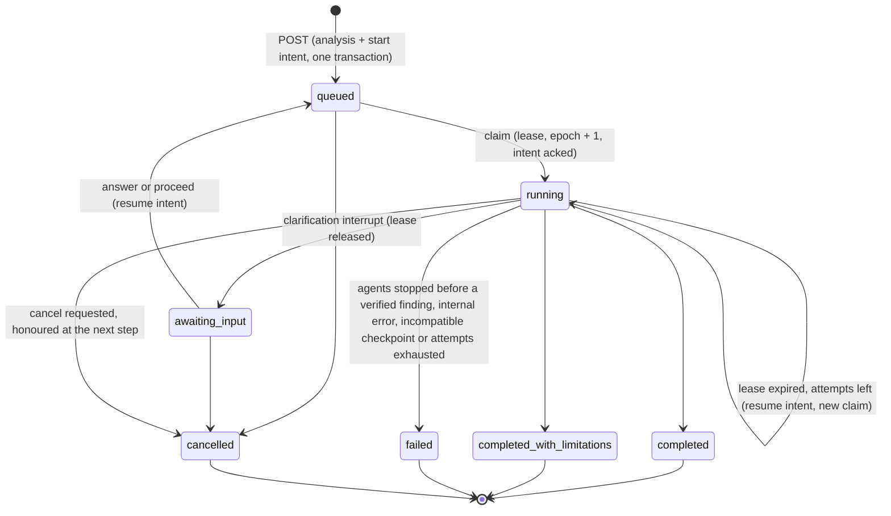
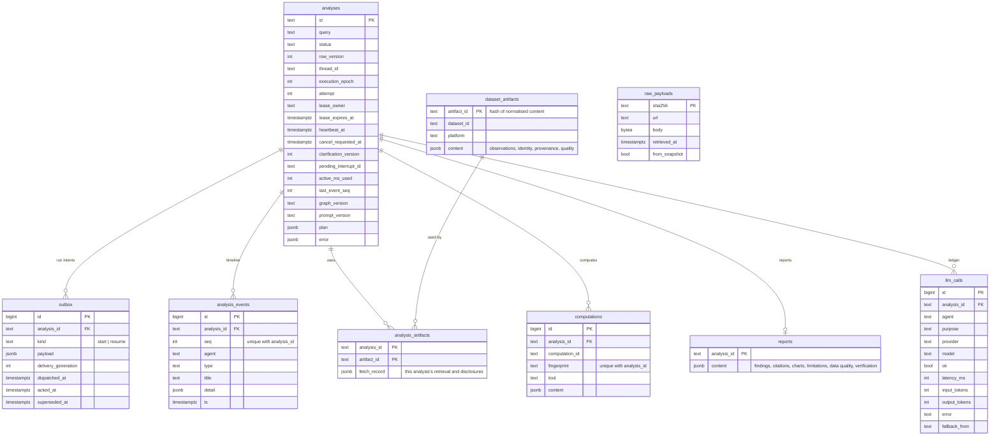

# Architecture

This document describes how the platform is built: its components, the agent workflow, how claims are verified, how analyses survive crashes and duplicates, how events reach the browser, the database schema, and the decisions behind them.

- [System overview](#system-overview)
- [Agent workflow](#agent-workflow)
- [Claim verification](#claim-verification)
- [Data integration](#data-integration)
- [LLM router](#llm-router)
- [Job lifecycle](#job-lifecycle)
- [Event delivery](#event-delivery)
- [Database schema](#database-schema)
- [API](#api)
- [Frontend](#frontend)
- [Design decisions](#design-decisions)
- [Scalability](#scalability)
- [Known limitations](#known-limitations)

## System overview

**Boundaries.**
- **One Python codebase, two entrypoints.** `uvicorn app.main:app` serves the API; `arq app.worker.settings.WorkerSettings` runs analyses. They share the models, the database layer and the settings. There are no microservices.
- **PostgreSQL is authoritative.** Every state change that matters (an analysis, its intents, its events, its evidence, its report) is committed there. Redis holds the job queue, wake-up hints, shared rate-limit slots and demo fault switches, all of which can be lost and rebuilt from Postgres.
- **The browser talks only to the API**, over REST and one WebSocket per analysis.

**Backend packages** (`backend/app/`):

| Package | Responsibility |
|---|---|
| `api/` | REST and WebSocket routes, RFC 7807 problem responses, demo fault routes |
| `agents/` | The graph, the plan, the ReAct loop, agent tools, prompts, report and export building |
| `analytics/` | Deterministic statistics with eligibility rules and refusal codes; correlation pairing rules |
| `grounding/` | The claim contract, the predicate registry, deterministic checks, rendering, citations, the qualitative judge |
| `connectors/` | SingStat, Data.gov.sg and MOM clients, the curated catalogue, shared rate limits, snapshot mode |
| `data/` | Series identity, the taxonomy, period handling, tidy series, cross-platform consistency checks |
| `jobs/` | Outbox, claim and lease, reconciler, fenced writer, fenced checkpointer, runner |
| `events/` | Reading committed events for the WebSocket |
| `llm/` | Router, provider construction, the offline stand-in, the scripted test double, pricing |
| `evaluation/` | Deterministic gates, live evaluation, resilience scenarios, judge suite, load driver |
| `db/`, `core/`, `worker/` | Models and sessions; settings, logging, fault switches; worker entrypoint and health |

## Agent workflow

Three agents collaborate through a LangGraph `StateGraph`. The graph state carries **references only** (the plan, round counts, the current objective); datasets, computations and claims live in the database and in a per-run evidence store, so checkpoints stay small and a resumed run reloads what it needs.

### Coordinator

- **Interpret.** The question becomes a typed `ResearchPlan`: whether it is in scope, sectors, metrics, period, requested frequency, sub-questions, assumptions, and clarification options when it is ambiguous. The plan is then normalised deterministically:
  - the period follows the question (`align_period`): it starts at the earliest year named and runs to the latest, "after" or "since" a year extends it to the latest complete year, and any change is recorded as an assumption;
  - a before/after question records where the later part starts (`comparison_start`);
  - only the domain vocabulary decides scope; a question about housing prices is declined, never answered with labour data.
- **Clarify.** An ambiguous question pauses with two to four options. Too many options go back to the model to choose from; truncation is the last resort. An answer re-plans once with the researcher's text; "proceed with stated assumptions" adopts the plan and records the assumption (or, when the plan has no sector or metric yet, re-plans with the most sensible default). Once answered, the plan doesn't ask again.
- **Supervise.** Each turn the Coordinator sees an evidence summary (datasets fetched, series selected and rejected, computations, refusals, verified and rejected claims, planned sector × metric pairs still without a series or without a finding, rounds used) and proposes `extract`, `analyse` or `report` with a public rationale.
- **Policy guards** dispose: analysis needs a selected series, a report needs at least one extraction round, and each agent gets at most two rounds. A refused proposal is replaced by a deterministic route with its own objective, and both the proposal and the override are shown in the timeline.
- **Report.** The report is built from verified claims only. The Coordinator writes a title, summary and limitations over the rendered findings; those are checked deterministically and by an LLM judge before they are kept.

### Extraction and Analytics (ReAct)

Both run the same loop (`agents/react.py`): the model reasons and calls a tool, the tool runs, and its result (or its error, as an observation the model can adapt to) goes back to the model, until it calls `finish`, stops calling tools, or exhausts its budget (14 tool calls for Extraction, 16 for Analytics, per round). Every tool call carries a short public `rationale` argument, which is what the timeline shows. No private chain of thought is stored or displayed.

| Agent | Tools |
|---|---|
| Extraction | `search_catalog`, `fetch_dataset`, `inspect_series`, `select_series`, `reject_series`, `check_consistency`, `finish` |
| Analytics | `list_evidence`, `compute`, `draft_claim`, `finish` |

- **Extraction judges fitness.** It can reject a series that doesn't fit the plan (wrong frequency, wrong reference convention, coverage that misses the period), and the rejection reason is recorded. Selecting a republished copy of a statistic already selected is refused, so one figure is never reported twice.
- **Analytics computes, then drafts.** `list_evidence` lists the selected series and suggested eligible computations with exact arguments, including every correlation pair a pairing rule allows. `compute` runs a deterministic tool (`change_between`, `yoy_change`, `cagr`, `trend`, `cumulative`, `compare_periods`, `correlate`, `value_at`) or returns a refusal code. `draft_claim` submits a claim bound to computation fields; the verifier answers immediately.

### Analysis sequence

## Claim verification

The central reliability rule: **an LLM never writes a number**. It chooses a predicate from a closed registry and binds it to a field of a stored computation; the platform renders the sentence and checks it.

- **Predicates** (`grounding/predicates.py`): `level.at`, `change.increase`, `change.decrease`, `cagr.growth`, `cagr.decline`, `trend.upward`, `trend.downward`, `flow.at`, `flow.total`, `period.higher`, `period.lower`, `assoc.positive`, `assoc.negative`, `assoc.weak`. Each declares the tools and value kinds it may describe, a sign rule and a sentence template.
- **A claim** is a kind (measured, comparison, association, recommendation, limitation), one or two assertions, and optionally one lead-in from a fixed list ("Over the same period,", "Meanwhile,", "By comparison,", "In contrast,", "Separately,", "In addition,", "Overall,"). Each assertion names its predicate, computation, field, metric, series and interval. The claim's text is composed by the platform: the lead-in, then the assertions' rendered statements joined by "and".
- **Deterministic checks** (`grounding/checks.py`), run on every claim:

| Check | Passes only when |
|---|---|
| `resolution` | The assertion's computation exists among this analysis's stored computations and has the named field (refused requests never become computations) |
| `predicate_fit` | The predicate is in the registry, and allows both the computation's tool and the field's value kind. This is what rejects a level presented as a change, a correlation coefficient as a measured change, or a percent-change field stated as a percentage-point one |
| `metric_equality` | The assertion's metric equals the field's metric (employment level, employment change and vacancies are all different) |
| `identity_equality` | The assertion's series key equals the key of the computation's first input series (for a correlation, the leading series). A parent/child swap or a tampered series reference fails |
| `interval_equality` | The assertion's interval is exactly the field's interval, start and end (a 2020–2024 change can't be restated as 2023–2024) |
| `sign_rule` | The value is strictly positive for a predicate that requires positive (`change.increase`, `cagr.growth`, `trend.upward`, `period.higher`, `assoc.positive`), or strictly negative for one that requires negative; zero satisfies neither |
| `strength_rule` | For association predicates: \|r\| ≥ 0.3 for `assoc.positive` and `assoc.negative`, \|r\| < 0.3 for `assoc.weak` |
| `kind_allowed` | The claim's kind is one the predicate allows, and an association claim rests on a computation whose interpretation is exploratory association (only `correlate` produces those) |
| `slots_bound` | The text's placeholder slots are exactly the claim's assertions, none missing and none extra |
| `safe_prose` | The text is exactly an allow-listed lead-in followed by the statements, in order. Any other wording, such as a negation ("It is false that …"), fails |
| `no_free_numbers` | Outside the rendered statements, the text contains no number except a period that is an asserted interval endpoint, or the year of one |
| `no_causal_language` | The text contains none of: *caused, causes, cause of, led to, leads to, drove, driven by, due to, because of, resulted in, result of, impact of, impacted, attributable to*, hedged or not |
| `recommendation_has_no_figures` | A recommendation binds no computed values |
| `finding_has_evidence` | Any claim other than a recommendation or limitation binds at least one computed value |

The first eight run per assertion; the rest per claim. A claim is retained only if every check passes.

- **Narrative checks.** The title, summary and limitations the Coordinator writes must pass `no_free_numbers` (periods allowed only when they are endpoints of verified findings) and `no_causal_language`, then an LLM judge (on the other provider when it is healthy) flags sentences that overstate or aren't supported by the verified findings. A flagged summary gets one rewrite, then is omitted. Whether the judge was independent of the writer is recorded and disclosed.
- **Citations are derived, never written.** Each finding's citations come from the lineage of its computations: dataset, version (artifact ID), title, publisher, origin agency, platform, series, periods, the dataset's human URL, retrieval time and whether it came from a snapshot. The API URL of each version is in the JSON export bundle.
- **Failures.** A rejected claim goes back to Analytics with the reasons. Planned items that end without a verified finding become deterministic limitations that say why, computed from the fetched data ("M182841 has it only for 2008 to 2025, not for all of 1985 to 1990").
- **Status.** An analysis that reaches the report step is `completed` only when it has at least one verified finding, every planned sector × metric pair is covered by one, and the method policy refused nothing during the run. Any refusal (for example the `REFERENCE_MISMATCH` on an annual correlation), any uncovered planned pair, or no findings at all (an out-of-scope question) makes it `completed_with_limitations`, with the refusals and gaps listed as limitations. Only verified findings reach the dashboard and the exports, whatever the status.

## Data integration

Covered in detail in [DATA_SOURCES.md](DATA_SOURCES.md). In short:

- **A curated catalogue** (`data/manifest/sources.yaml`) of nine datasets on three platforms, each with its full identity: metric, measure type, reference convention, population, unit, scale, classification and mirrors. `search_catalog` is a lexical search over it.
- **Connectors** for SingStat (JSON, point-based paging with fragment merging), Data.gov.sg (CSV download preferred, datastore JSON as fallback) and MOM (Excel workbook discovered from the index page, CSV as fallback).
- **Series identity** (`data/identity.py`): classification system and version, code set, population, measure type, unit, scale, frequency and reference convention. Parent and child sectors stay distinct; incompatible identities are refused, never joined.
- **Quality**: pandera schema checks on every source, source-defined markers (never imputed), unit and legend verification against the manifest, cross-platform consistency checks at published precision.
- **Immutable, content-addressed artifacts.** A dataset version's ID hashes its normalised observations, source metadata and every blocking issue, never the raw bytes (SingStat stamps every response). Raw payloads are stored separately by SHA-256 as provenance.
- **Snapshot mode** (`DATA_MODE=snapshot`) serves the committed real-data captures; a live failure also falls back to them, disclosed.

## LLM router

`llm/router.py` sits between the agents and the providers.

- **Order and fallback.** Providers are tried in `LLM_PROVIDER_ORDER`. Each gets at most two attempts on retryable errors (throttling, timeouts, 5xx) with backoff, then the next provider is tried. A `provider_fallback` event says why.
- **The router owns retries.** SDK retries are off: OpenAI `max_retries=0`; Bedrock `total_max_attempts=1`, which means exactly one HTTP request per attempt.
- **One deadline per call site.** Retries, the structured-output repair and fallback all draw from the analysis's active-time deadline (240 s by default; time paused for clarification is excluded), with a reserve kept for the fallback provider.
- **Circuit breaker** per provider: three consecutive failures open it for 60 s, and fallback events made while it is open still state the original failure.
- **Normalisation.** Nova returns private `reasoning_content` blocks; the router strips them. Only tool arguments and text are used.
- **Ledger.** Every call is recorded in `llm_calls`: provider, model, agent, purpose, tokens, latency, success, error and the provider it fell back from. Cost is computed from `LLM_PRICES` and shown only when every call's usage is known.
- **Degraded modes.** When the agents can't continue (both providers unavailable, the deadline spent, or the step limit hit), what happens depends on whether any finding was verified yet. None: the analysis fails with `LLM_UNAVAILABLE` (or `STEP_LIMIT`), claiming nothing. Some: it ends `completed_with_limitations` with the verified findings, a limitation saying it stopped early, and no generated title or summary.
- **Offline mode.** With `LLM_MODE=offline` the router builds a deterministic stand-in for every model. It is refused in production and recorded in the ledger as `offline-<provider>`.

## Job lifecycle

Analyses run asynchronously and must survive worker crashes, lost queue messages, duplicate deliveries and races between clarify and cancel. Durability lives in Postgres; Redis is a delivery mechanism.

- **Transactional outbox.** Creating an analysis inserts the row and a `start` intent in one transaction; the intent is then dispatched to arq. A crash between commit and enqueue leaves an undispatched intent, which the reconciler dispatches.
- **Atomic claim.** A worker claims in one transaction: it takes a 60 s lease, sets `running`, increments the **execution epoch** (the fencing token) and the attempt, acknowledges its intent and supersedes every other open intent. A delivery whose intent is already acknowledged or superseded, or whose analysis is terminal or paused, exits without side effects.
- **Fencing.** Every authoritative write (heartbeats, events, artifacts, computations, the report, status changes and LangGraph checkpoints) is conditioned on `execution_epoch = my_epoch`. A worker that lost its lease gets `LeaseLost` on its next write and stops. Checkpoint writes re-check the epoch under a per-analysis advisory lock in the same transaction, with `durability="sync"`, so a checkpoint can't land after the lease has moved.
- **Two counters.** `outbox.delivery_generation` counts redeliveries of an intent nobody acknowledged; `analyses.attempt` counts executions that actually started. Only executions count against the limit of three, so queue loss can't exhaust the recovery budget.
- **Reconciler** (every 15 s in every worker, safe to run concurrently with `SKIP LOCKED`): dispatches undispatched intents, and redispatches intents dispatched but unacknowledged for 60 s. For a running analysis whose lease expired and which has no open intent, it cancels it if cancellation was requested; otherwise it writes a resume intent while attempts remain, or fails it after three. **A recovered analysis stays `running` throughout:** the resume intent's claim takes a new lease and a new epoch, which fences the old worker. Ending it (cancelled or failed) bumps the epoch too. The reconciler never touches terminal or paused analyses, and a healthy run keeps renewing its lease every 15 s.
- **Idempotent effects.** Computation IDs derive from a fingerprint of tool, method version, input artifacts and series identities, periods and options, so a step restarted after a crash reuses its rows (`UNIQUE (analysis_id, fingerprint)`). Artifacts are content-addressed. Events are unique on `(analysis_id, seq)`. The report and the terminal status commit together or not at all. LLM calls may repeat on resume; exactly-once billing is not promised.
- **Clarification.** The graph interrupts; the worker sets `awaiting_input`, releases the lease and ends the job, and the deadline clock pauses. An answer is accepted only by a conditional update (`status = 'awaiting_input'` and the submitted version equals the current one) that bumps the version, sets `queued` and writes a resume intent, in one transaction. A rejected answer gets the first matching error, in this order:
  1. `404` when the analysis doesn't exist;
  2. `409 ALREADY_TERMINAL` when it has finished or been cancelled;
  3. `409 CLARIFICATION_STALE` when the version differs from the current one. This is also what a duplicate of an accepted answer gets, since acceptance bumped the version, even though the analysis is no longer paused;
  4. `409 NOT_AWAITING_INPUT` otherwise (the right version, but the analysis isn't paused).

  The answer is keyed by the interrupt it answers, so it survives a crash of the worker that resumed it.
- **Cancel** always returns `202` for an analysis that is queued, paused or running, and records `cancel_requested_at`:
  - **queued or paused:** it becomes `cancelled` at once, its open intents are superseded and a terminal event is written;
  - **running:** it stays `running` until the worker reaches the next node or tool-call boundary and ends it as `cancelled`. The final transitions (pause, finish) re-check the request under the row lock, so a cancel after the last boundary still wins and the report is discarded. If the worker has died, the reconciler cancels it instead of resuming it;
  - **terminal:** `409 ALREADY_TERMINAL`.

  **Cancellation takes precedence over an answer,** and the analysis ends `cancelled` whichever lands first:
  - **cancel first:** the answer gets `409 ALREADY_TERMINAL`;
  - **answer first, not yet claimed:** the analysis is `queued` with a resume intent. The cancel cancels it at once and supersedes the intent, and a claim only succeeds on a queued or running analysis with an open intent, so the answer never runs;
  - **answer first, already claimed:** a worker took the resume intent before the cancel arrived, so the analysis is `running` again. The cancel is then a request like any other on a running analysis: the resumed run stops at its next node or tool-call boundary (or at the final pause or finish, which re-check it) and ends `cancelled`, discarding any report. Steps run between the claim and that boundary, including LLM calls, are not undone.
- **Active-time budget.** Heartbeats add active time; pause and finish add the remainder. A recovered run is charged for the interval its crashed worker never reported, so recovery can't grant extra time.
- **Checkpoint compatibility.** A checkpoint from an incompatible graph version is not resumed; the analysis fails with `INCOMPATIBLE_CHECKPOINT`.

## Event delivery

The timeline must show every committed event once, in order, through reconnects, dropped hints and replay.

- **Emit.** A fenced transaction increments `analyses.last_event_seq`, inserts the event with that sequence number, and commits. Only then is `seq` published to Redis, as a wake-up hint.
- **WebSocket handler** (`/ws/analyses/{id}?after_seq=`): subscribe to the hint channel first, then loop: drain committed events after the cursor (200 per page), send them, and wait for a hint or a 2 s timer. Each drain re-reads committed rows, so an event committed during replay, or a hint lost after commit, is still delivered. The loop ends once the terminal status has been sent and the drain is empty.
- **Sends are awaited**, so a slow client only slows its own handler; there is no per-connection buffer to overflow.
- **Client.** The browser merges events by `seq` (duplicates dropped, order restored) and reconnects with backoff using the last seen `seq` as the cursor, so the timeline converges on the committed history.
- **Commit time.** Each event carries `ts` (when its transaction started) and `committed_at` (when it committed, where Postgres tracks commit timestamps, as in the end-to-end stack). The load run measures delivery from `committed_at`.

## Database schema

`raw_payloads` stands alone: artifacts list the hashes of the payloads they were built from. LangGraph's checkpoint tables are created by the checkpointer and keyed by `thread_id` (the analysis ID). Migrations are in `backend/alembic/versions/`.

## API

| Method and path | Purpose | Notable responses |
|---|---|---|
| `POST /api/analyses` | Submit a question (3–1000 characters) | `202` with the ID; `422` on invalid input |
| `GET /api/analyses?cursor=&limit=&status=` | History, newest first, keyset-paginated, filterable by status | |
| `GET /api/analyses/{id}` | The analysis: status, plan, pending question, report, usage | `404` |
| `POST /api/analyses/{id}/clarify` | `{clarification_version, answer}` or `{clarification_version, proceed_with_assumptions: true}` | `409 CLARIFICATION_STALE`, `409 NOT_AWAITING_INPUT` |
| `POST /api/analyses/{id}/cancel` | Cancel, or request cancellation of a running analysis | `409 ALREADY_TERMINAL` |
| `GET /api/analyses/{id}/export?format=md\|json\|csv` | Markdown report, JSON bundle with pinned dataset versions, CSV of the observations used | `409 REPORT_NOT_AVAILABLE` |
| `WS /ws/analyses/{id}?after_seq=` | Committed events after the cursor, then live | close `4404` for an unknown analysis |
| `GET /api/health` | Database and Redis health | |
| `GET/PUT/DELETE /api/admin/faults[/{name}]` | Demo fault switches; mounted only when `ENABLE_FAULT_INJECTION=true`, never in production | |

Errors are RFC 7807 `application/problem+json` with a stable `code`; no stack traces leak. OpenAPI is served at `/docs`.

## Frontend

Next.js 16 (App Router), React 19, TypeScript and Tailwind CSS 4, with Recharts for charts.

- **`/`**: the question form with sample queries, service health and the history list (status filter, "Load more").
- **`/analyses/{id}`**: the plan card (sector, metrics, period, frequency, comparison split, assumptions), the agent timeline (one lane per agent with rationales, tool calls and results, decisions and policy overrides, fallbacks, quality reports), the clarification card, then the report: findings with their citations, charts with series toggles, a period filter and a table view, the data-quality panel, limitations, usage (calls, tokens, latency, cost when priced) and the three exports.
- **Live updates** come from `useEventStream`, which merges events by `seq` and reconnects from the last seen cursor.
- **Accessibility and layout:** severity is shown with an icon and a word, never colour alone; every chart has a table view; the layout works at 375, 768 and 1280 px without sideways scrolling (checked by the browser tests).

## Design decisions

| Decision | Why | Trade-off |
|---|---|---|
| **The platform renders every numeric sentence** from a closed predicate registry | Free LLM prose around numbers produced garbled and duplicated statements in early live runs, and can't be verified | Findings read more uniformly; the narrative adds connective prose only |
| **Verification is a mandatory gate, not a fourth agent** | An optional agent can be skipped; a gate can't | The Coordinator's report step depends on it |
| **LLM proposes, policy disposes** for routing | Keeps autonomy (the model chooses) while making budgets and preconditions unbreakable | Overrides are visible in the timeline |
| **Public rationale as a required tool argument** | Nova returns its explanation only as private reasoning, which the router strips | One extra argument per tool |
| **Custom ReAct subgraphs** instead of a prebuilt agent | Control over events, budgets, cancellation checks and error observations | A little more code |
| **Postgres outbox, lease and epoch fence** instead of trusting the queue | Redis loss, duplicate deliveries and stale workers can't corrupt an analysis | The lifecycle code is the most involved part of the backend |
| **Synchronous checkpoint durability** | With asynchronous durability a checkpoint could land after the lease moved and be fenced, losing a step | Slightly slower steps |
| **Content-addressed artifacts from normalised content** | Raw bytes change daily for unchanged data (SingStat's `dateGenerated`) | Raw payloads stored separately for provenance |
| **Curated catalogue with full identity metadata** | Correct joins need reference conventions, populations and classifications that search results don't carry | New datasets need a catalogue entry |
| **Lexical catalogue search** | Nine entries; an embedding index would add a service for no gain | Synonyms come from keywords |
| **Exploratory correlation only, no p-values** | Consecutive quarters are serially dependent; n is 19–20 | Associations are labelled exploratory, never causal |
| **Router-owned retries with SDK retries off** | One deadline and one ledger entry per attempt; no hidden retries | The router is ours to maintain |
| **Offline stand-in for end-to-end and load tests** | The whole platform is exercised with no provider spend, and its output is verified like a real model's | It knows only one topic |
| **Cache Components disabled in Next.js** | Under partial prerendering the analysis page's Suspense boundary never resolved on the client | The analysis route renders on request |

## Scalability

- **Workers scale horizontally.** Each runs four analyses concurrently (`max_jobs`). Claims, leases, the reconciler and rate limits are coordinated through Postgres and Redis, so adding worker containers adds capacity. The load run's queue wait (p50 2.6 s with 10 concurrent analyses on one worker) is what more workers remove.
- **The API is stateless.** WebSocket handlers read from Postgres, so API replicas can sit behind a load balancer without sticky sessions.
- **Source rate limits are global.** Data.gov.sg's published limits are shared across every worker through Redis, so scaling out doesn't trigger throttling.
- **Database growth.** Events and observations dominate. At larger scale: partition `analysis_events` by time, move artifact observations to a columnar table, and add read replicas for history and detail reads.
- **LLM throughput** is bounded by provider quotas. The circuit breaker and fallback keep analyses moving when one provider throttles.

## Known limitations

- **No authentication or authorisation.** The app is for a local or private demo. Production use needs an authenticating proxy (SSO) and per-user history.
- **Nine curated datasets** in one domain (the labour market by industry). Other questions are declined rather than answered badly.
- **The fallback needs two funded provider accounts.** It was evaluated live in both directions (see [TESTING.md](TESTING.md#live-evaluation-make-eval-live)); the OpenAI account used for that has since run out of credits, so a live fallback demo needs credits or another configured provider.
- **LLM calls may repeat** when a crashed step is resumed.
- **Model output is not streamed** to the browser; findings appear once verified.
