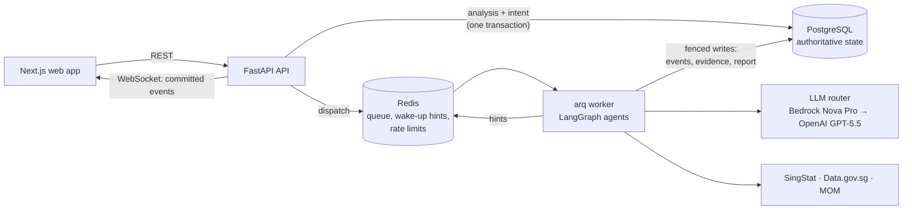

# Agentic Policy Data Analytics Platform

Policy researchers ask a question in plain English, for example *"Analyse employment trends in the technology sector from 2020-2024"*. Three collaborating agents find the relevant Singapore government datasets, fetch and validate them, compute the statistics and return a report. Every number in the report is verified against the computation behind it and cited to the dataset version it came from.

- **Coordinator** turns the question into a research plan, asks when the question is ambiguous, decides each next step and writes the report from verified findings only.
- **Extraction** (ReAct) searches a curated catalogue, fetches from SingStat, Data.gov.sg and MOM (JSON APIs, CSV and Excel), validates the data and rejects series that don't fit the plan.
- **Analytics** (ReAct) runs deterministic statistics (change, CAGR, trend, period comparison, exploratory correlation) and drafts claims bound to those computations.

A deterministic verifier checks every claim before it can reach the report. LLMs choose and phrase; they never produce a number. The UI streams each agent's reasoning, tool calls and results live.

## Contents

- [Architecture at a glance](#architecture-at-a-glance)
- [Quick start](#quick-start)
- [Running without Docker](#running-without-docker)
- [Tests and evaluation](#tests-and-evaluation)
- [Sample queries](#sample-queries)
- [Configuration](#configuration)
- [Deployment](#deployment)
- [Technology choices](#technology-choices)
- [Troubleshooting](#troubleshooting)
- [Further documentation](#further-documentation)

## Architecture at a glance



PostgreSQL holds all state; Redis holds only what can be rebuilt from it. One Python codebase runs as the API and as the worker. See [ARCHITECTURE.md](ARCHITECTURE.md) for the agent graph, the claim contract, the job lifecycle and the database schema.

## Quick start

**Prerequisites:** Docker Desktop (or Docker Engine with Compose v2) and `make`. Nothing else is needed for the Docker setup.

1. **Clone and configure.**

   ```bash
   git clone https://github.com/SaadUlHassan/agentic-policy-analytics.git
   cd agentic-policy-analytics
   cp .env.example .env
   ```

2. **Choose how the agents get a model.**

   - **No credentials (free, deterministic):** set `LLM_MODE=offline` and `DATA_MODE=snapshot` in `.env`. A deterministic stand-in answers every LLM step on the committed real-data snapshots, and everything it drafts passes through the same verifier. It knows one topic, ICT employment and vacancies, so use the first sample query. Nothing leaves your machine.
   - **Live models:** fill in `AWS_BEDROCK_API_KEY` (and `AWS_BEDROCK_REGION`) for the primary, and `OPENAI_API_KEY` for the fallback. With only one provider, list just that one in `LLM_PROVIDER_ORDER` (for example `bedrock`); with both, the router falls back from the first to the second. `DATA_MODE=live` fetches from the government APIs; `snapshot` uses the committed snapshots.

3. **Start the stack.**

   ```bash
   make up
   ```

   This builds the images, runs the database migrations and waits until Postgres, Redis, the API, the worker and the web app are all healthy (about two minutes on a first build, plus downloading the base images).

4. **Use it.** Open <http://localhost:3000>, pick a sample query or type your own, and watch the agents work. The API is on <http://localhost:8000> (OpenAPI docs at `/docs`).

5. **Check it end to end** (optional): `make smoke` calls the health endpoint and runs a job through the worker.

`make down` stops the stack and keeps the database; `make reset` also deletes it. `make help` lists every target.

## Running without Docker

For development with hot reload. Needs Python 3.12 with [uv](https://docs.astral.sh/uv/), Node 22, and Postgres 16 and Redis 7 running locally (or just those two from compose: `docker compose up -d postgres redis`).

```bash
# Backend: API and worker (two terminals), from backend/
cd backend
uv sync
uv run alembic upgrade head
uv run uvicorn app.main:app --reload --port 8000
uv run arq app.worker.settings.WorkerSettings

# Frontend, from frontend/
cd frontend
npm ci
npm run dev        # http://localhost:3000, talks to http://localhost:8000
```

The backend reads `.env` from the repository root. Without `DATABASE_URL` and `REDIS_URL` it uses `localhost:5432` and `localhost:6379`.

## Tests and evaluation

Everything below except `make eval-live` and `make probe` is offline: no LLM calls, no spend.

**Host tools.** Unlike `make up`, these commands run on the host, so they need the native toolchain from [Running without Docker](#running-without-docker): Python 3.12 with uv, Node 22, and the installed dependencies.

```bash
(cd backend && uv sync)
(cd frontend && npm ci)
(cd frontend && npx playwright install chromium)   # browser tests only
docker compose up -d postgres redis                # integration tests and the live evaluation
```

The integration tests and the live evaluation use the compose Postgres and Redis on `localhost:5432` and `localhost:6379`. They create their own databases (`policy_test`, `policy_eval`) and Redis databases (15, 14), so they never touch the app's data. If you changed `POSTGRES_PORT` or `REDIS_PORT`, point them there with `TEST_DATABASE_URL` / `TEST_REDIS_URL` (`EVAL_DATABASE_URL` / `EVAL_REDIS_URL` for the live evaluation). When Postgres or Redis can't be reached, the integration tests are **skipped**, not failed; set `REQUIRE_INTEGRATION=1` to make that an error, as CI does.

| Command | What it runs | Needs |
|---|---|---|
| `make test` | 374 backend tests (unit, integration, evaluation) and 31 frontend tests | uv and Node dependencies; Postgres and Redis for the 105 integration tests |
| `make coverage` | The same, with coverage; backend core packages are gated at 80% (currently 94%) | as `make test` |
| `make eval` | Deterministic gates: golden computations against independently computed values, refusal correctness, the adversarial verifier suite. Writes `eval/results/deterministic.{json,md}` | uv dependencies only |
| `make e2e` | Playwright browser tests at 375, 768 and 1280 px against an isolated offline stack (ports 8200/3200), torn down afterwards | Docker, Node dependencies and Playwright's Chromium |
| `make load` | The 5-minute load run against the offline stack. Writes `eval/results/load/load.{json,md}` | Docker and uv dependencies |
| `make lint`, `make typecheck` | ruff and ESLint; mypy and `tsc` | uv and Node dependencies |
| `make eval-live` | Live golden runs on both provider orders, consistency, provider resilience, LLM-judge suite. Writes `eval/results/live/` | uv dependencies, Postgres and Redis, credentials; **spends LLM calls** |
| `make probe` | Capability probe of the configured models (tool call, structured output, a ReAct turn, streaming) | uv dependencies and credentials |

CI (GitHub Actions) runs lint, types, all tests, the coverage gate, the evaluation gates, a secret scan, compose smoke tests of the development and production configurations, the browser tests and a 30-second load smoke on every pull request and on pushes to `main` and `v*` tags. On those pushes it then publishes the images to GHCR.

[TESTING.md](TESTING.md) has the strategy, the hallucination-detection methodology and every result.

## Sample queries

The golden evaluation set, all answerable from the catalogued data except where noted:

| Question | What it shows |
|---|---|
| Analyse employment trends in the technology sector from 2020-2024 | Change, CAGR and trend on SingStat; vacancies cross-checked against Data.gov.sg. **Works offline.** |
| How did employment in information and communications change in 2023 compared with 2022? | Year-on-year change |
| What was the compound annual growth rate of employment in information and communications between 2020 and 2024? | CAGR |
| Did quarterly employment growth in information and communications weaken after mid-2022, compared with 2020 to mid-2022? | Period comparison split where the question says |
| Were ICT job vacancies and quarterly ICT employment change related between 2020 and 2024? | Exploratory correlation, lag 0 (n=20) and lag 1 (n=19) |
| Is annual employment in information and communications correlated with annual ICT job vacancies from 2020 to 2024? | Refused: year-end levels against quarter-averaged vacancies (`REFERENCE_MISMATCH`) |
| How did job vacancies in IT and other information services change compared with the wider ICT sector, 2020 to 2024? | Subsector kept distinct from its parent |
| How is the sector doing? | Ambiguous: the Coordinator asks which sector (also works offline) |
| Analyse employment in information and communications from 1985 to 1990 | Outside the data's coverage: a limitation explaining why, no figures |
| What happened to HDB resale flat prices in 2024? | Out of domain: declined, no analysis fabricated |

The supported domain is the Singapore labour market by industry: employment levels and changes, job vacancies and recruitment rates, at national level.

## Configuration

All settings come from environment variables (`.env` locally). [.env.example](.env.example) lists them with comments. The ones that matter most:

| Variable | Default | Meaning |
|---|---|---|
| `LLM_MODE` | `live` | `offline` uses the deterministic stand-in (refused when `APP_ENV=prod`) |
| `LLM_PROVIDER_ORDER` | `bedrock,openai` | Primary first; the router falls back in this order |
| `AWS_BEDROCK_API_KEY`, `AWS_BEDROCK_REGION`, `BEDROCK_MODEL_ID` | —, `ap-southeast-1`, `apac.amazon.nova-pro-v1:0` | Bedrock primary |
| `OPENAI_API_KEY`, `OPENAI_MODEL` | —, `gpt-5.5` | OpenAI fallback |
| `LLM_PRICES` | unset | USD per million input/output tokens by model ID; cost is shown only when every model used is priced |
| `DATA_MODE` | `live` | `snapshot` reads the committed real-data snapshots instead of the government APIs |
| `DATAGOV_API_KEY`, `DATAGOV_KEY_TIER` | —, `dev` | Optional Data.gov.sg key and the tier it was issued for (raises the shared rate limits). Left empty, it is no key and the tier is ignored |
| `ENABLE_FAULT_INJECTION` | `false` | Demo switches for provider and source outages (`/api/admin/faults`); refused when `APP_ENV=prod` |
| `WEB_PORT`, `API_PORT`, `POSTGRES_PORT`, `REDIS_PORT` | 3000, 8000, 5432, 6379 | Host ports, all bound to loopback |

Secrets never enter git: `.env` is ignored, CI uses GitHub Secrets, and gitleaks scans every push.

## Deployment

`docker-compose.prod.yml` runs the images CI publishes to GHCR (`ghcr.io/saadulhassan/agentic-policy-analytics-{backend,web}`, tagged `sha-<commit>`, the branch or tag name, and `latest` from `main`).

1. On the host, clone the repository (the data directory with the catalogue and snapshots is mounted from it) and create `.env` with the provider credentials.
2. Set a database password; it may contain any character:

   ```bash
   export POSTGRES_PASSWORD='...'
   # optional: pin a release
   export BACKEND_IMAGE=ghcr.io/saadulhassan/agentic-policy-analytics-backend:sha-<commit>
   export WEB_IMAGE=ghcr.io/saadulhassan/agentic-policy-analytics-web:sha-<commit>
   make prod-up
   ```

3. Production settings are enforced: `APP_ENV=prod`, fault injection off (the routes don't exist), offline mode refused, Postgres and Redis not published, API and web on loopback, services restarting unless stopped.

**Before exposing it beyond the host:** the app has no authentication, so put it behind an authenticating reverse proxy (TLS, SSO). The web image has the API address built in (`NEXT_PUBLIC_API_URL`), so rebuild it for a public address. Scale out by running more worker containers: jobs, leases and rate limits are coordinated through Postgres and Redis.

If the GHCR packages are private, `docker login ghcr.io` with a token that can read them first.

## Technology choices

| Area | Choice | Why |
|---|---|---|
| Agents | LangGraph `StateGraph` with custom ReAct subgraphs, a Postgres checkpointer | Explicit control over routing guards, budgets, events, interrupts for clarification, and resume after a crash |
| LLMs | AWS Bedrock Nova Pro (primary), OpenAI GPT-5.5 (fallback) behind an own router | Both passed the capability probe. The router owns retries (SDK retries off), circuit breaking, fallback and the call ledger |
| API | FastAPI, Pydantic v2, SQLAlchemy 2 async, Alembic | Async REST and WebSocket, typed contracts, OpenAPI, RFC 7807 errors |
| Jobs | arq, with a transactional outbox, leases and an epoch fence in Postgres | asyncio-native; durability lives in Postgres, not in Redis |
| Data and statistics | pandas, pandera, NumPy, SciPy, statsmodels, openpyxl | Schema checks on every source; OLS with Newey-West intervals; Excel workbooks |
| Storage | PostgreSQL 16, Redis 7 | One authoritative store; Redis only for queue, hints and shared rate limits |
| Frontend | Next.js 16, React 19, TypeScript, Tailwind CSS 4, Recharts | Typed end to end, responsive, accessible charts with table views |
| Testing | pytest, respx, Vitest and Testing Library, Playwright | Scripted LLM doubles for mechanics; independent expectations for numbers |
| Delivery | Docker multi-stage images, Compose, GitHub Actions, GHCR, gitleaks | One command locally; the same images in CI and production |

The reasoning behind each design decision is in [ARCHITECTURE.md](ARCHITECTURE.md#design-decisions).

## Troubleshooting

- **Running a second copy beside an existing one:** compose names the project `policy-analytics`, so a second checkout would share the first one's containers and database volume. Give it its own name and ports, for example `COMPOSE_PROJECT_NAME=policy-copy` with different `*_PORT` values in its `.env`.
- **A port is already in use:** change `WEB_PORT`, `API_PORT`, `POSTGRES_PORT` or `REDIS_PORT` in `.env`. If you change `API_PORT`, rebuild the web image (`make up` does).
- **An analysis fails with `LLM_UNAVAILABLE`:** neither provider answered. Check the credentials, or run with `LLM_MODE=offline`. `make probe` shows what each configured model can do.
- **Bedrock says the model is not available:** request model access in the Bedrock console for your region, or set `BEDROCK_MODEL_ID` to a model you have access to and re-run `make probe`.
- **Data.gov.sg is slow:** without an API key it allows only a few requests per 10 seconds, and the platform spaces its requests to stay inside that (see [DATA_SOURCES.md](DATA_SOURCES.md#rate-limits-and-api-keys)). Register a free key (`DATAGOV_API_KEY`) or use `DATA_MODE=snapshot`.
- **Integration tests are skipped:** they need Postgres and Redis reachable at `localhost:5432` and `localhost:6379` (`docker compose up -d postgres redis`), or at `TEST_DATABASE_URL` / `TEST_REDIS_URL`. `REQUIRE_INTEGRATION=1` turns a skip into a failure.

## Further documentation

- [ARCHITECTURE.md](ARCHITECTURE.md): system design, agent workflow, claim verification, job lifecycle, event delivery, database schema, design decisions.
- [TESTING.md](TESTING.md): test strategy, hallucination detection, evaluation gates and results, load results.
- [DATA_SOURCES.md](DATA_SOURCES.md): every dataset with its identity, definitions and quirks; the snapshot approach; adding a source.
- [docs/INNOVATION.md](docs/INNOVATION.md): how the platform would evolve for secure government environments, with what exists now and what to build next.
- [docs/IMPLEMENTATION_PLAN.md](docs/IMPLEMENTATION_PLAN.md): the plan the build followed, with the outcomes recorded at each milestone.
